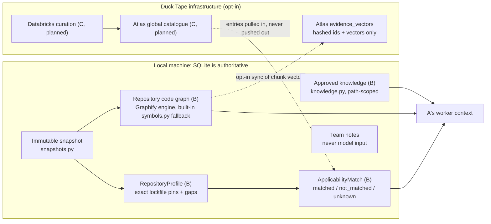
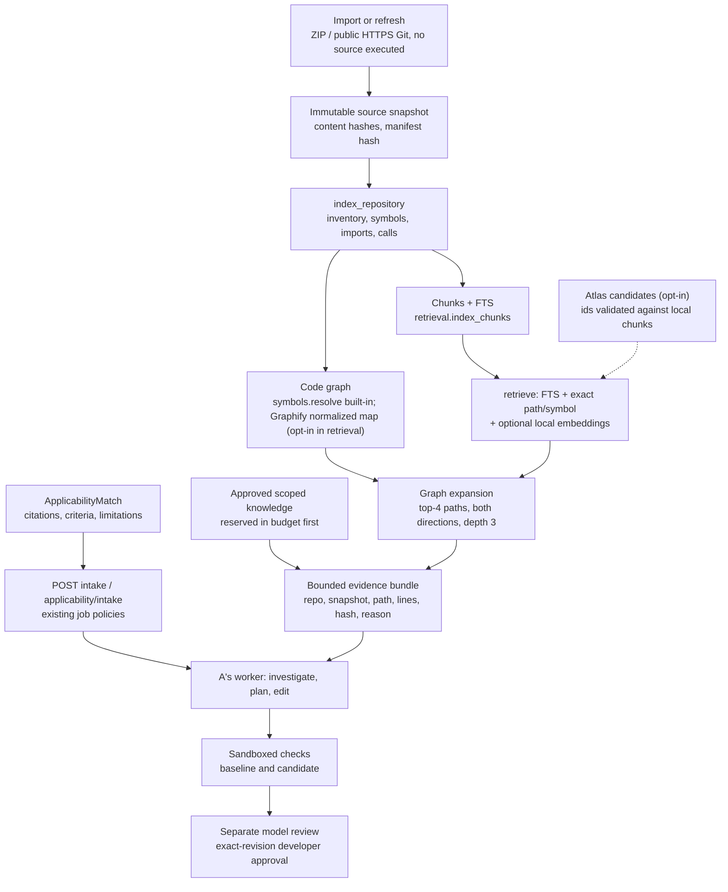

# Knowledge graphs

Duck Tape keeps three separate kinds of knowledge and joins them only on the local machine. This page explains each layer, who owns it, how evidence flows from an imported snapshot to A's worker, and what is implemented today versus planned. Team roles follow [TEAM_PLAN.md](hackathon/TEAM_PLAN.md): **A** models and the worker, **B** repository knowledge, **C** global knowledge. The payload contract is [KNOWLEDGE_CONTRACT.md](hackathon/KNOWLEDGE_CONTRACT.md); retrieval measurements are in [RETRIEVAL.md](RETRIEVAL.md).

## The three layers

| Layer | Owner | What it holds | Storage | Status |
| --- | --- | --- | --- | --- |
| Repository code graph | B | Files, symbols, import/call/test/re-export edges, routes, boundaries, unresolved references for one immutable snapshot | SQLite, inside the repository index | Built-in graph (`backend/symbols.py`) and Graphify knowledge map (`backend/graphify_graph.py`) implemented |
| Approved team knowledge | B | Versioned decisions, conventions and constraints with path scope and cited evidence | SQLite `knowledge` / `knowledge_versions` | Implemented (`backend/knowledge.py`) |
| Public global catalogue | C | Vulnerabilities, improvements, framework and research updates with affected-version rules and revisions | Databricks curation, published to separate Atlas collections | Planned; local labelled fixture only |

The **applicability match** (B, `backend/applicability.py`) is the only join between the private repository and the public catalogue. It runs locally against a snapshot-bound `RepositoryProfile`; neither the profile nor the match is uploaded.

`knowledge.py` scope `global` (like `*` and `repository`) means the **whole current repository**. It is not the cross-repository catalogue.

## Data flow: snapshot to reviewed patch

1. **Snapshot.** `snapshots.py` captures immutable blobs; refresh writes a new managed directory instead of overwriting the source checkout.
2. **Index.** `repository.index_repository` inventories every entry as `indexed`, `excluded`, `unsupported` or `failed` with a reason, parses Python (AST) and JS/TS/TSX (Tree-sitter), then calls `symbols.resolve` to build the graph.
3. **Retrieve.** `retrieval.retrieve` scores persisted chunks (full-text, exact path/symbol, optional embeddings, optional Atlas), then expands the graph and fills a byte-bounded budget.
4. **Act.** A's worker receives the evidence bundle plus approved knowledge and decisions, applies structured edits, runs checks in the sandbox and requests a separate review. Approval binds the exact revision, diff hash and check evidence ([ARCHITECTURE.md](ARCHITECTURE.md)).

### Graph expansion in retrieval

With `graph=True` (the default), the paths of the four highest-scoring chunks form the frontier. For up to three rounds, every edge in `index['edges']` touching the frontier is followed in both directions. The related file's chunk covering the edge's evidence line is scored `10 - 2 * depth` (10, 8, 6), with reason text such as `graph calls (parsed/resolved binding) via app.py`. Chunks that cover the resolved import/call lines get up to 32 extra points. The first chunk of each documentation, configuration or dependency file gets a floor score of 1. Overlapping ranges in the same file are deduplicated; non-adjacent ranges are kept.

### Atlas vector candidates (opt-in)

`retrieve(..., atlas=True)`, or `STEWARD_ATLAS_RETRIEVAL=1` with `STEWARD_ATLAS_ENABLED=1`, calls `_atlas_candidates`, which wraps `data_platforms.atlas_search`. Only chunk IDs that resolve to locally eligible chunks of the same repository and snapshot (and any `paths` filter) count; text always comes from local evidence. Any failure leaves keyword/graph retrieval in place with an `Atlas candidates unavailable (...)` note. The worker currently calls `retrieve` with a stored index dictionary (the legacy form), which never adds Atlas candidates or Graphify edges; the repository `search` and `ask` routes can.

On the 14 November 2026 live fixed-task run, graph + Atlas had lower file recall than graph alone on 3 of 6 tasks (0.75 versus 1.00 on `quote`, `quoteTS` and the quantity-bug query) and equal recall on the other three ([evidence](evidence/retrieval-atlas-live.json)). Atlas scores can displace graph neighbours, so the switch stays **off by default**.

## Node and edge schema

### Built-in graph (`symbols.resolve`, implemented)

| Node field | Meaning |
| --- | --- |
| `id` | `{snapshot}:{path}` for files; `{snapshot}:{path}:{qualified_name}:{start_line}` for symbols |
| `kind` | `file`, or the parser node type (`FunctionDef`, `AsyncFunctionDef`, `ClassDef`, `function_declaration`, `class_declaration`, `method_definition`, `interface_declaration`, `type_alias_declaration`, `variable_declarator`) |
| `path`, `name` | Snapshot-relative path; symbol name for symbol nodes |
| `evidence` | `{repo_id, snapshot_id, path, blob_hash, start_line, end_line}`, clamped to the file length |

| Edge field | Meaning |
| --- | --- |
| `source`, `target` | File paths in the same snapshot (edges are file-to-file) |
| `kind` | `imports`, `reexports`, `tests` (import from a test file) or `calls` |
| `symbol` | Called expression, for `calls` edges |
| `confidence` | `parsed/resolved` for imports; `parsed/resolved binding` for calls |
| `line`, `evidence` | Source line and range of the import or call |
| `target_evidence` | Target file, or the called symbol's line range |

The result also carries `unresolved` (external imports, dynamic imports, calls whose binding is not statically resolved), `routes` (FastAPI-style decorators and Express-style calls, labelled `parsed declaration; framework binding not proven`), `boundaries` (dependency, configuration, schema/migration, build/CI, test and documentation files) and `capabilities`. Unresolved references are recorded, never guessed into edges. Static resolution covers relative and package imports, tsconfig `paths`/`baseUrl`, workspace packages and `exports`, re-exports, local-variable shadowing and default exports; dynamic dispatch remains incomplete.

### Knowledge map (`backend/graphify_graph.py`, implemented)

[Graphify](https://github.com/Graphify-Labs/graphify) (PyPI `graphifyy`, Apache-2.0) builds tree-sitter AST graphs for about 40 languages, with community clustering. `knowledge_graph(repo_id, snapshot_id, engine)` normalizes its `graphify-out/graph.json` into one snapshot-bound schema, which the built-in graph also uses (`builtin()`):

| Element | Normalized fields |
| --- | --- |
| Graph | `kind: knowledge_graph`, `schema_version`, `engine` (`graphify` or `duck-tape-symbols`), `engine_version`, `repo_id`, `snapshot_id`, `gaps`, `stats` (nodes, edges, inferred edges), `graph_hash`; Graphify results add `attribution` |
| Node | `id` (`file:<path>`, `graphify:<id>` or `symbol:<path>:<name>:<line>`), `label`, `kind` (`file`, `class`, `callable`, `symbol`, or the built-in parser kind), `path`, `line`, `community` |
| Edge | `source`, `target`, `relation` (Graphify's own, such as `calls`, `imports`, `imports_from`, `contains`, `method`, `inherits`, `uses`), `confidence` (`EXTRACTED`/`INFERRED`; built-in edges keep `parsed/resolved...`), `score`, `evidence {path, line}`, `suggestion_only`; each file also `defines` its symbols |
| Community | `{id, size}` from Graphify clusters (none for the built-in graph) |

Implementation rules:

- **Isolated runtime.** A separate CLI: `uv tool install graphifyy==0.9.108 --python 3.11`, found on `PATH`, in `~/.local/bin` or via `STEWARD_GRAPHIFY_BIN`. Never installed into the app venv or an imported repository.
- **Immutable input.** The snapshot is materialized into an empty scratch directory under the data directory, then deleted after the run.
- **Offline.** `graphify extract <copy> --code-only` with an allowlisted environment (no model keys), `GRAPHIFY_BACKEND=none`, `GRAPHIFY_QUERY_LOG_DISABLE=1`, a 180-second timeout and a 64 MiB output cap.
- **Validated.** A node survives only if its path is an indexed file and its line is within that file; edges need validated endpoints and evidence. Unlocated nodes, external/library symbols, dropped edges and truncation (20,000 nodes, 60,000 edges) are recorded as gaps.
- **Cached.** SQLite `knowledge_graphs` records keyed by repository, snapshot, pinned Graphify version, schema version and file hashes.
- **Fallback.** `GET /api/repositories/{id}/graph?engine=auto` (the default) falls back to the built-in graph with a gap naming the failure; `engine=graphify` returns 503 instead; `engine=builtin` skips Graphify.
- **Trust.** `INFERRED` edges are `suggestion_only`: navigation hints, not evidence. With `graph_engine='graphify'` or `STEWARD_GRAPH_ENGINE=graphify` (default `builtin`), retrieval adds only cross-file `EXTRACTED` edges with relations `calls`, `imports`, `imports_from`, `inherits`, `mixes_in`, `uses` or `references` to graph expansion, and `mode` gains `+ graphify`.

Measured on 14 November 2026: on the bundled Parcel sample, Graphify 0.9.108 produced 15 nodes, 21 edges and 3 communities (the test fixture, `tests/fixtures/graphify/parcel-graph.json`). On the fixed retrieval fixture it produced 34 validated nodes, 52 edges and 18 cross-file EXTRACTED edges. Retrieval with Graphify edges matched the built-in graph's file recall and precision on all 6 tasks at limits 4, 6 and 12 ([evidence](evidence/retrieval-graphify.json)); the built-in parser already resolves those relationships on this small fixture. Graphify's value here is the snapshot-wide knowledge map (communities, symbol-level calls, about 40 languages) rather than a measured retrieval gain.

### Profile and match (`backend/applicability.py`, implemented)

| Object | Key fields |
| --- | --- |
| `RepositoryProfile` | `repo_id`, `snapshot_id`, `index_snapshot`; `packages` (ecosystem, name, version, path, `manifest_hash`, `start_line`/`end_line` of the pin); `gaps` with path/ecosystem; `capabilities`; `profile_hash` |
| `ApplicabilityMatch` | `status` (`matched`, `not_matched`, `unknown`); profile and entry identity (`entry_id`, `entry_revision`, `entry_hash`, `entry_status`); `evidence`; `citations`; `rationale`; `acceptance_criteria`; `limitations`; `match_key` |

Profiles reuse `signals.dependencies()`: `package-lock.json` v2/v3, pinned `requirements.txt`/`requirements.lock` and registry packages in `uv.lock`. Other lockfiles, loose ranges and unsupported ecosystems stay `unknown`. A version match establishes affected-version applicability, never exploitability; improvements are hypotheses until measured. `intake_payloads` maps a current, active match to existing `POST /api/intake` bodies (`vulnerability` to `security`, `improvement` to `analysis`, framework/research updates to `research`).

#### Public catalogue adapter and route

`from_global_entry` converts C's `GlobalEntry` (or a `Catalogue.query` / `query_atlas` item) into the matcher shape: `canonical_id` becomes `id`, `material_revision` the `revision` and `source_content_hash` the `content_hash`. Status is `withdrawn` when `withdrawn_at` is set, `stale` when freshness is not `fresh` or the last source refresh failed, else `active`. OSV `{type, events}` ranges are flattened into `introduced`/`fixed`/`last_affected` intervals; any range type or event sequence that cannot be read stays an explicit unsupported marker, so the result is `unknown`, never `not_matched`. C's schema has no CWE or symbol fields, so none are carried and `sink_reachable` stays null. `/applicability` and `/applicability/intake` accept either shape (records with `canonical_id` are converted); `_entry` still validates.

`POST /api/repositories/{id}/applicability/catalogue` takes `{snapshot_id?, provider: "local"|"atlas", limit?: 1..100}`. It profiles the current snapshot (409 if stale), queries the catalogue for each distinct resolved (ecosystem, package) (at most 200), matches locally and returns `{profile, provider, queried, matches, entries, coverage: "unknown", limitations, errors}`. It creates no jobs; proposals still go through `/applicability/intake`. `local` (default) reads only the separate local catalogue file; `atlas` sends package names from the private profile to the public catalogue cluster, so it is an explicit choice, and an Atlas failure is HTTP 503 with unknown coverage, never a local fallback. Real-record evidence (public OSV `CVE-2024-35195` against a labelled demo repository pinning `requests==2.31.0`): [applicability-real-osv.json](evidence/applicability-real-osv.json), produced by `python scripts/evaluate_applicability_real.py`.

### Agent graph context (`backend/agent_context.py`, implemented)

`agent_graph_context(repo_id, snapshot_id, query, budget_tokens=3500, job=None, entries=None)` and `GET /api/repositories/{id}/agent-context?query=…&budget_tokens=…&job_id=…` return **`graph_context v1`**, the block A's agents receive inside `<graph_context>…</graph_context>`. Every `?` field may be null, and null means unknown, never false.

| Key | Content and limits |
| --- | --- |
| `scope` | `repo_id`, `snapshot_id`, `engine` (`duck-tape-symbols` or `graphify`), `engine_version?`, `graph_hash` |
| `focal_symbols[]` | Symbols inside the retrieved ranges: `node_id`, `path`, `start_line`, `end_line?`, `kind`, `label`, `signature?` (declaration text at `start_line`, untrusted source), `community?` (Graphify only), `degree` (resolved static call sites into the symbol), `high_degree` (top 10% of this snapshot, at least 3) |
| `edges[]` | Structural edges touching focal files: `relation`, `confidence` (`EXTRACTED` for parsed or Graphify-extracted, else `INFERRED`), `suggestion_only`, `evidence{path, line}`. `AMBIGUOUS` is never produced |
| `blast_radius` | `dependent_files`, `linked_test_files` (static test imports only), `communities_touched?`, `structural_risk` (labelled heuristic), `basis` |
| `catalogue_matches[]` | From the job's stored match (`job_id`) or entries passed in: `status`, lockfile `citations`, `limitations`, `cwe?`, `directly_imported?`, `sink_reachable?`, per-package `usage` evidence |
| `approved_knowledge[]` | Current team-approved knowledge only (never drafts, stale records or team notes) |
| `gaps[]`, `context_hash` | Everything missing or trimmed, and a hash of the block |

**Usage and reachability rule.** For each matched package the builder looks for static imports of its import names (PyPI names are normalised, with a small table for names that differ, such as PyYAML → `yaml`) and resolves calls through those bindings.
- `directly_imported` is `true` with file:line evidence, `false` when parsed files have no static import, or null when dynamic imports or unparsed files leave it open. `false` does not mean unreachable: a transitive dependency runs without being imported.
- `sink_reachable` is `true` only when a resolved static call matches an affected symbol named by the public entry (`affected_symbols` or OSV-style rule `symbols`). Otherwise it is null ("not shown reachable"); it is never `false`.

The block is bounded in UTF-8 bytes like retrieval. Edges, then focal symbols, then knowledge are trimmed first, and each trim is recorded in `gaps`. Nothing is uploaded.

## Isolation, refresh and invalidation

- **Snapshot binding.** Every node, edge, chunk, citation and profile carries repository and snapshot identity plus a content hash. `load_index` rejects a snapshot from another repository, and `index_chunks` refuses a changed index for an existing snapshot.
- **Current snapshot only for matching.** The profile and applicability routes return 409 for a non-current `snapshot_id`.
- **Refresh.** `refresh_repo` replaces the current index and edges, keeps historical snapshots readable as history, fails every non-terminal job for the repository and marks knowledge stale when cited or scoped files changed. Deleted files cannot return as current evidence.
- **Lockfile change or deletion.** The old job is invalidated on refresh; re-matching the new snapshot gives `not_matched` (or `unknown`) without citations, and intake creates no new job (`tests/test_applicability_sample.py`).
- **Catalogue revision or withdrawal.** `match_key` ignores retrieval timestamps but changes with the material revision or content hash. `applicability/intake` calls `_invalidate_catalogue_jobs`, which fails open jobs for that entry whose evidence fingerprint is no longer current. A withdrawn or stale entry is labelled and withheld from intake; rejected or snoozed decisions on unchanged evidence are kept.
- **Knowledge changes.** Approving or revising team-approved knowledge fails active jobs in that scope so they retry with current decisions.

### What never leaves the machine

| Data | Rule |
| --- | --- |
| Team notes | Never enter retrieval, embeddings, prompts, training or cloud analytics. A note becomes knowledge only by explicit promotion plus approval. |
| Repository profile, matches, decisions | Computed and stored locally; never pushed to the public catalogue. |
| Atlas `evidence_vectors` | Only SHA-256 repository/snapshot/embedding-space identifiers, deterministic chunk IDs and vectors. No source text, paths or symbol names; secret-bearing files are excluded whole. Queries are embedded first and refused if they look like credentials. |
| Atlas graph mirror (`repo_nodes`, `repo_edges`, `approved_knowledge`) | Explicit opt-in, separate from vector retrieval: needs `STEWARD_ATLAS_GRAPH_MIRROR=1` plus the Atlas settings, private database only (never `*_public`). Sends node labels, paths, line numbers, declaration lines, edge relations and team-approved, non-stale, non-conflicting knowledge text. Never sends team notes, drafts, jobs, profiles, file bodies or evidence text; secret-bearing files are excluded whole, as for vectors. |
| Graphify | Code-only and offline on a scratch copy; no LLM backend, model keys or query log. |
| Databricks metrics | Hashed run/repository IDs and allowlisted counts, timings and statuses only. |

Embeddings are still source-derived data, and a configured remote embedding provider receives the text it embeds. Choose explicitly which repositories may use Atlas.

## Current versus planned

| Capability | Status | Where |
| --- | --- | --- |
| Built-in code graph (Python AST, JS/TS Tree-sitter, file and symbol nodes, import/call/test/re-export edges) | Implemented | `backend/symbols.py`, `backend/repository.py` |
| Retrieval with graph expansion (depth 3), FTS, exact matches, optional local embeddings | Implemented | `backend/retrieval.py` |
| Approved scoped knowledge with versioning and invalidation | Implemented | `backend/knowledge.py` |
| RepositoryProfile, ApplicabilityMatch, intake mapping and routes (`/profile`, `/applicability`, `/applicability/intake`) | Implemented, tested against a labelled local fixture | `backend/applicability.py`, `backend/main.py` |
| Opt-in Atlas vector candidates | Implemented, off by default; live-measured 14 Nov 2026 with lower recall on 3 of 6 fixed tasks | `backend/retrieval.py`, `backend/data_platforms.py` |
| Opt-in Atlas graph and approved-knowledge mirror (`POST /api/repositories/{id}/atlas-graph-mirror`): idempotent upsert, one snapshot per repository | Implemented, off by default; mocked-collection tests only, not yet live-checked | `backend/atlas_graph.py`, `tests/test_atlas_graph.py` |
| Graphify engine: normalized graph, SQLite cache, `GET /api/repositories/{id}/graph`, opt-in retrieval edges | Implemented: fixture, mocked-subprocess and real installed-CLI tests; retrieval default stays `builtin` (no measured gain) | `backend/graphify_graph.py`, `tests/test_graphify_graph.py` |
| Databricks public-source ingestion/curation and Atlas catalogue publication | Planned (C) | [KNOWLEDGE_CONTRACT.md](hackathon/KNOWLEDGE_CONTRACT.md) |
| Runtime catalogue lookup feeding the matcher (`POST /applicability/catalogue`, `from_global_entry`) | Local provider implemented and tested with one real public OSV record against a labelled demo repository; Atlas provider tested with a mocked transport only (not run live from this route); no worker or UI wiring yet | `backend/applicability.py`, `backend/main.py`, `tests/test_applicability_catalogue.py` |
| Agent graph context `graph_context v1` (signatures, degree, blast radius, catalogue usage evidence, `GET /agent-context`) | Implemented, fixture-tested; not yet called by the worker | `backend/agent_context.py`, `tests/test_agent_context.py` |
| Worker retrieval and graph context | Planned (A): the worker still calls the legacy index-dict form of `retrieve` and does not yet include `graph_context` | `backend/worker.py` |
| UI graph view | Planned; designs in progress in Figma | |

Fixture, mocked-transport and live results are reported separately. A configured integration is not a connected one, and a connected one is not qualified.
